<!-- ========================= BANNER ========================= -->

  <a href="https://github.com/daviferreira-dev"></a>

  

  
  
  

 

<!-- ========================= SOBRE MIM ========================= -->

<!-- ========================= FICHA ========================= -->

<!-- ========================= HABILIDADES ========================= -->

<!-- ========================= INVENTÁRIO ========================= -->

<!-- ========================= MISSÃO PRINCIPAL ========================= -->
<a href="[LINK DO REPOSITÓRIO DO AUTO ABOUT]"></a>

<!-- ========================= DIÁRIO DE MISSÕES ========================= -->

<!-- ========================= CONQUISTAS ========================= -->

<!-- ========================= CERTIFICADOS ========================= -->

<!-- ========================= MAPA ========================= -->

<!-- ========================= REGISTRO DE AVENTURA ========================= -->

  
  
  

 

<!-- ========================= CONTINUE ========================= -->

  

  
  

 

<!-- ========================= RODAPÉ ========================= -->
